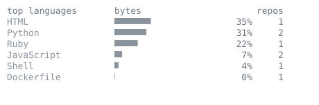

# Beatriz Barguil

`Salesforce Developer` `Apex · LWC · Flow` `SAP integration`

I spent nine years writing user stories as a Product Owner, until I got too curious about what happened after the handoff. Now I write the code myself, mostly Apex, LWC and Flow, wiring Salesforce into SAP and whatever else it needs to talk to.

Off the clock I point code at the things I love: satellites, mountains, music and the ocean.

**Certified:** Salesforce Administrator · SAFe PO/PM · SAFe Agilist

 

### 🧰 Languages and Tools

### Featured projects

|  |  |
|:--|:--|
| **[Ice Wall Finder](https://github.com/BeBarguil/icewall-finder)** — maps steep ice slopes in the Himalaya from satellite data · *Earth Engine* | **[Spotify Genre Sorter](https://github.com/BeBarguil/spotify-genre-sorter)** — sorts Liked Songs into genre playlists · *Python* |

Also: [swell-finder](https://github.com/BeBarguil/swell-finder) · [run_together](https://github.com/BeBarguil/run_together) 
### Stats

 
